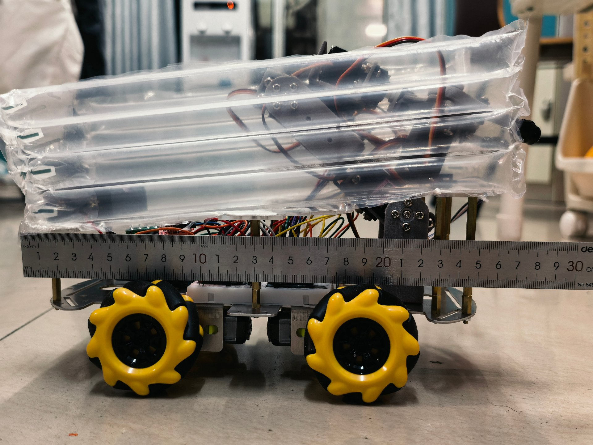
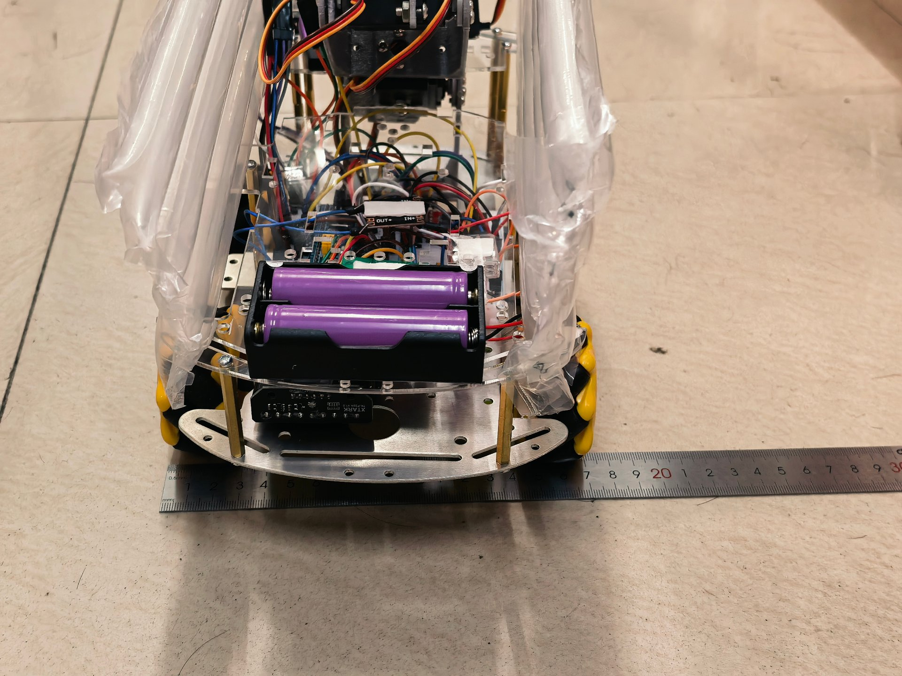
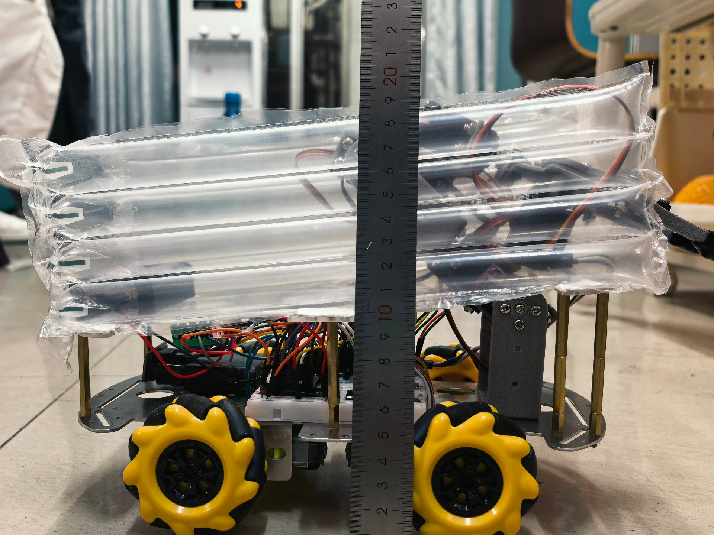

# Zymspaz 战队机器人设计思路及制作过程

> **队伍名称**：Zymspaz 战队（CRTC2026 新生组）
> **主控**：STM32F103C8T6（HAL 库，STM32CubeMX + CLion）
> **控制方式**：PS2 无线手柄手动遥控 + 麦克纳姆轮全向底盘 + 舵机机械臂
> **整机预算**：约 ¥176.74 / 台，两台合计约 ¥353.48（上限 ¥400.00）
> **文档更新时间**：2026-10-18
> **说明**：本文档按各功能模块的**完成时间点从早到晚**组织，每个板块由"功能描述 + 开发历程与迭代"构成。标注 `[电控组]` / `[机械组]` 的为对应小组主要负责内容。

## 目录

| 序号 | 板块 | 时间 | 对应中期考核指标 |
| --- | --- | --- | --- |
| 一 | 总体设计思路：预算与重量约束下的方案选型 | 2026.09 – 2026.10 | 规划 / 采购单 |
| 二 | 底盘与越障系统 `[机械组]` | 09.27 – 10.09 | 外形展示 |
| 三 | 工程环境搭建 `[电控组]` | 09.28 – 09.30 | — |
| 四 | GPIO 与 PWM 电机控制 `[电控组]` | 09.30 – 10.02 | 电机运动（单一 / 全部） |
| 五 | 机械臂抓取与收纳 `[机械组]` | 09.30 – 10.12 | 方块携带（单一 / 多项） |
| 六 | 舵机控制 `[电控组]` | 10.02 – 10.05 | 舵机运动（单一 / 多项） |
| 七 | 麦轮运动学解算 `[电控组]` | 10.05 – 10.08 | 底盘运动 |
| 八 | PS2 手柄遥控 `[电控组]` | 10.08 – 10.12 | 底盘运动（单一 / 全部） |
| 九 | 电路焊接与走线 `[机械组]` | 10.09 – 10.12 | 结构稳定性 |
| 十 | 串口调试工具 `[电控组]` | 10.12 – 10.17 | — |
| 十一 | 尺寸与重量规范测量 | 10.18 | 尺寸规范 |
| 十二 | 核心部件采购清单与成本核算 | — | 规划 / 采购单 |
| 十三 | 开源与原创说明 | — | — |

---

## 一、总体设计思路：预算与重量约束下的方案选型（2026.09 – 2026.10）

### 1.1 我们面对的约束

拿到规则时，机械组的同学心里其实都没底：**2.0kg 的重量上限、400 元的整机预算、还要爬 300mm 的高台**。这基本上堵死了使用大功率电机和厚重金属结构的可能，所有设计都必须在"预算 + 重量"的夹缝里做减法。

### 1.2 第一版方案的教训：差点被"全自动"拖垮

一开始我们心气很高，想做全自动机器人，甚至去查了树莓派和 OpenMV 的套件。但一算账就傻了：光视觉模块就远远超过整个预算，而且重量也不轻。我们不得不面对现实——**在这个预算下，稳定完赛比炫技更重要**。

最终决定放弃全自动视觉方案，改用 **PS2 手柄手动控制**，把精力转向机械结构的可靠性。电控组据此采用手动遥控路线：硬件器件优先选用官方物资表内物料以降低额外采购成本；主控使用 STM32F103C8T6 核心板，基于 HAL 库搭建 STM32CubeMX + CLion 开发环境，将电机、舵机、手柄通信分层封装，便于调试迭代。

### 1.3 部件选型对比（方案及理由）

**（1）主控：STM32F103C8T6 / Arduino / 其他 F4 板**

- 官方物资表指定，培训与物资统一；
- F103 引脚 5V 容忍，配合 PS2 与 DRV8833 免电平转换；
- 资源足够 4 路 PWM + SPI + UART + FreeRTOS。

**（2）电机驱动：DRV8833 / TB6612 / L298N**

- DRV8833 双路 H 桥、内置保护、体积小、价格低；
- TB6612 同样优秀但不在官方物资表内；
- L298N 压降大、功耗高，弃用。

**（3）舵机：SG90 / MG996R / MG995**

- SG90 轻量便宜，用于轻负载关节；
- MG996R 扭矩大，用于抬升 / 夹爪；
- MG995 官方表有但功耗高，仅在需要大力矩处使用。

**（4）遥控：PS2 无线 / 蓝牙 / 红外**

- 官方规则唯一推荐；
- 2.4G 抗干扰好；
- 摇杆模拟量适合麦轮全向控制。

### 1.4 重量控制：从 2.5kg 到 1.9kg 的生死线

第一版车装出来往秤上一放，2.5kg——**直接超重 25%**，而且还没算电池和配重。没办法，只能推翻重来。我们重新审视图纸，做了两件事：

1. **改机械臂图纸**：把原本厚重的多关节结构，改成更简单的"连杆 + 舵机"方案，不仅承重更合理，还省下大量空间；
2. **改用 3D 打印**：放弃原本想用的铝板，把能打印的零件全换成 PLA。打印件精度虽不如金属，但胜在轻。

最终整机控制在约 1.9kg，满足 2.0kg 上限。

---

## 二、底盘与越障系统 `[机械组]`（2026.09.27 – 2026.10.09）

> **对应考核指标**：外形展示（至少一台具有能量单元的完整机器人机体）

### 功能描述

底盘必须能爬上 150mm 的台阶，还要能过拱桥（b4 / c4）。我们选用官方物资表里的 TT 马达和 60mm 麦轮，通过自行设计的**低重心布局**保证稳定性。

### 开发历程与迭代

**第一阶段：麦轮打滑与"砂纸大法"（2026.09.27）**

第一次测试爬 150mm 台阶，麦轮疯狂打滑，车头翘起来就是上不去。我们一开始以为是电机扭矩不够，差点就要换电机。

> **思考与解决**：后来分析，TT 马达本来就没劲，麦轮在光滑的台阶边缘抓地力又差，硬冲是不行的。除了调整重心，我们决定在物理层面增加摩擦力——买来粗砂纸，把麦轮的橡胶外圈打磨粗糙。这招"土办法"出奇地有效。同时把电池仓移到底盘最下方做低重心设计，车终于能稳稳爬上台阶。

**第二阶段：电机反转与拆装（2026.10.09）**

第一次联调时发现左边的轮子往前转、右边的往后转，车直接在原地打转。

> **思考与解决**：排查电控代码后确认是电机线序接反。TT 马达没有防呆接口，只能把轮子拆下来重新焊接线序。虽然只是个小问题，但对第一次做车的我们来说，拆了装、装了拆，折腾了一整晚。

**当前进度**：底盘可完成爬台阶与过拱桥动作，四驱已跑通（配合电控麦轮解算）。

---

## 三、工程环境搭建（STM32CubeMX + CLion） `[电控组]`（2026.09.28 – 2026.09.30）

### 功能描述

建立可复现的开发环境：CubeMX 生成 HAL 工程骨架，CLion + CMake 编译，ST-Link 烧录。工程结构区分 `Core`（CubeMX 生成区）与 `App`（自研封装区）。

### 开发历程与迭代

**第一阶段：工具链搭建与工程目录划分**

1. **环境链**：STM32CubeMX（6.x）生成 `.ioc` → CLion 以 CMake 方式打开 → STM32CubeCLT 工具链编译 → ST-Link V2 烧录。CLion 的 `CMakeLists.txt` 由 CubeMX 转换器生成，工程名为 `${CMAKE_PROJECT_NAME}`。

2. **工程结构设计**（对齐电控培训第 2 板块"工程结构设计"要求）：`Core/` 存放 CubeMX 生成的 `main.c`、`tim.c`、`gpio.c`、`usart.c` 等；`App/` 存放自研封装 `servo.c`、`motor.c`、`mecanum.c`、`ps2.c` 及各库头文件。`CMakeLists.txt` 中通过 `target_sources` 将 App 源文件加入编译，App 目录加入 include 路径。

**第二阶段：编译报错与工程配置排错**

1. **CMakeLists 修改要点**：`add_executable` 只声明目标，源文件统一放 `target_sources`；新增 App 文件后需把 `.c` 加进 `target_sources`、App 目录加进 `target_include_directories`，否则报"找不到文件 / 未定义引用"。
2. App 中的 `.c` 文件不能被 `main.c` 用 `#include` 引入（会与 CMakeLists 已编译的同一文件重复定义）；`main.c` 只需在 USER CODE 区加函数原型声明后直接调用。
3. **外设配置注意**：SPI1 挂 APB2、USART1 挂 APB2、TIM2 / TIM4 挂 APB1，时钟树需与手册教程一致（SYSCLK = 72MHz）。

**当前进度**：完整开发环境搭建完毕，工程目录规范化，可正常完成编译、烧录操作。

---

## 四、GPIO 与 PWM 电机控制 `[电控组]`（2026.09.30 – 2026.10.02）

> **对应考核指标**：电机运动（单一）能完成至少一个电机的转动；电机运动（全部）能完成不少于 4 个电机的转动

### 功能描述

通过 GPIO 输出方向电平 + 定时器 PWM 输出调速，驱动 4 路 TT 马达，实现每路正转 / 反转 / 停，满足"至少一个电机转动"与"不少于 4 个电机转动"两项指标。

### 开发历程与迭代

**第一阶段：引脚分配、硬件参数与调试流程**

- 电机 PWM = PA0 ~ PA3（TIM2_CH1 ~ CH4），方向 = PB0 / PB1 / PB12 / PB13，LED = PC13；
- TIM2 配置为 4 通道 PWM1 输出，Prescaler = 71、Period = 999（1kHz）；
- DRV8833 双片，每片驱动 2 路（#1 管 LF + LB，#2 管 RF + RB）；AIN1 / BIN1 接 PWM，AIN2 / BIN2 接方向；VM = 7.4V，GND 与主板共地，STBY 焊死 3.3V。

**调试流程**：先单路点亮（GPIO 翻转 LED）→ 单路 PWM 调速 → 4 路全部驱动 → 接线图定稿（版本 A：保持 DRV8833、借鉴 TB6612 样式）。

**第二阶段：定时器参数重置、引脚浮空、外设未启用故障排查**

1. **PWM 频率被重置故障**：CubeMX 重新生成后 TIM2 Period 被重置为 65535，PWM 频率 = 72MHz / 72 / 65536 ≈ 15Hz，TT 马达只抖不转（嗡嗡声）。
   **修复**：TIM2 Prescaler = 71、Counter Period = 999，恢复 1kHz。**教训**：每次重新生成代码后核对 TIM2 参数。
2. **方向引脚浮空输入故障**：GPIOB 方向脚（PB1 / PB12 / PB13）若未在 CubeMX 配置为 GPIO_Output，处于浮空输入，`HAL_GPIO_WritePin` 写不出电平，DRV8833 IN2 悬空导致正反转同向。
   **修复**：CubeMX Pinout 将 PB1 / PB12 / PB13 设为 GPIO_Output（PB0 已有）。
3. **串口句柄未定义**：`motor_test_main.c` 引用 `huart1` 但 CubeMX 从未启用 USART1，链接报 undefined reference。**修复**：CubeMX 启用 USART1（PA9 / PA10、115200、8N1），生成 `usart.c` 后自动解决。

**当前进度**：4 路电机已可正常转动、方向可控；马达方向调试程序 `motor_test_main.c` 逐路输出 `dir_polarity` 汇总，用于校正每路接线极性（反接改 `motor_init` 参数，不改线）。底盘 4 驱已跑通。

---

## 五、机械臂抓取与收纳 `[机械组]`（2026.09.30 – 2026.10.12）

> **对应考核指标**：方块携带（单一）至少一台机器人可以自主使至少一颗在地面静止的方块（30×30×30mm）由非携带状态转变为携带状态；方块携带（多项）在保持已携带方块的状态下，再使至少一块地面静止方块转变为携带状态

### 功能描述

规则要求比赛结束时必须"携带"方块才算分。我们最初设计的简单机械臂无法精准抓取、角度难控制，通过改进关节处的扭动才顺利抓取。舵机用于抬升机构与夹爪。

### 开发历程与迭代

**第一阶段：机械臂抓取角度失控（2026.09.30）**

我们设计了一个三自由度机械臂，用 MG995 舵机驱动，想让它像人手一样精准抓取方块。第一版和第二版机械臂抓取角度极其难控制：舵机稍微转多一点，爪子就撞地；转少一点，又夹不住。特别是黄色方块（15mm）太小，机械臂的爪子根本捏不住，经常把方块推飞。

> **思考与解决**：我们意识到，在 2kg 的重量限制下做复杂的机械臂是不现实的。于是果断简化图纸，重新设计了抓取范围和自由度更高的**四自由度机械臂**，改成更灵活、更好操控旋转的样式。改良后的结构比第一版精准得多——虽然不能一下子铲入盒子，但胜在灵活便捷。

**第二阶段：焦点区域的取物难题（2026.10.12）**

中央高地的"焦点"上有一个黄色方块，周围有 10mm 高的矮墙限位。我们的机械臂太厚太宽，进不去那个矮墙的缝隙。**解决**：继续精简机械臂，增加铰链来抓取缝隙中的方块。

**当前进度**：机械臂可完成地面静止方块的抓取与携带（演示见"方块携带.mp4"）。

---

## 六、舵机控制 `[电控组]`（2026.10.02 – 2026.10.05）

> **对应考核指标**：舵机运动（单一）能完成至少一个舵机的转动；舵机运动（多项）同一台机器人能完成至少三个舵机的转动，并确保其可动机构能够在任意非初始状态下保持相对静止

### 功能描述

驱动 SG90 / MG996R 舵机，满足"至少一个舵机转动"与"同一台机器人至少三个舵机转动且可动机构在任意非初始状态保持相对静止"两项指标。舵机用于抬升机构与夹爪。

### 开发历程与迭代

**第一阶段：舵机库封装与硬件参数确定（2026.10.10）**

舵机库 `servo` 采用参数化封装：

- `servo_init(ch, htim, channel, min_deg, max_deg, home_pol)` 在 `main.c` 登记硬件绑定，换引脚只改 init 一行；
- 上电自动回中点（安全姿态）；
- 支持最多 10 路逻辑编号（0 ~ 9），TIM4_CH1 ~ CH3 对应 PB6 / PB7 / PB8。

**硬件参数**：MG996R 扭矩约 9.4kg·cm、金属齿轮，适合抬升 / 夹爪大负载；SG90 扭矩约 1.8kg·cm、重量轻，适合轻负载关节。两型均 180° 舵机，脉冲范围 500 ~ 2500us（中值 1500us）。

**第二阶段：定时器时基配置错误造成角度偏移（2026.10.17）**

1. **脉宽精度坑**：servo 库要求 1us / 格计数时钟；若 TIM4 计数时钟配成 100kHz（10us / 格），脉宽计算整体错位，舵机角度不准。**修复**：PSC 按 1MHz 计数时钟配置（TIM4 PSC = 71、Period = 1999 → 20ms 周期 50Hz）。
2. **上电回中点**：init 时写入中值脉宽，防止上电瞬间舵机乱转碰坏机构。

**当前进度**：3 路舵机驱动验证完毕，可独立转动并锁止保持位置；抬升、夹爪联动逻辑等待机械装配完成后开展联调。

---

## 七、麦轮运动学解算 `[电控组]`（2026.10.05 – 2026.10.08）

> **对应考核指标**：底盘运动（培训第 4 板块 / 底盘全部运动）

### 功能描述

将操作手的平移（vx、vy）与自转（ω）指令解算为 4 路麦轮速度，使底盘可全向移动（前进 / 横移 / 旋转 / 组合弧线），支撑"使用 PS2 手柄控制全部车体水平运动"指标。

### 开发历程与迭代

**第一阶段：运动学算法实现与软件封装**

采用 **X 型麦轮排布**解算公式：

```c
LF = vx - vy - omega * k;
RF = vx + vy + omega * k;
LB = vx + vy - omega * k;
RB = vx - vy + omega * k;   // k = 旋转手感系数，默认 0.6
```

`mecanum` 库为纯数学封装：`mecanum_calc(vx, vy, omega, out[4])`，输出直接喂给 `motor_set_all`。包含死区 0.12（摇杆静止漂移抑制）与归一化（四轮速度超 1 时等比缩放）。

**第二阶段：运动调试经验总结**

1. **轮子转向约定**：速度大于 0 时轮子上边缘朝向车头；四轮电机极性统一在 `motor_init` 软件参数内校正，参数错误会造成整车原地自旋。
2. **旋转系数 k** 控制转向灵敏度：k 越大转向越灵敏，k 越小转向越平缓；0.6 为实测合适数值，比赛阶段可根据操作员习惯微调。
3. **双摇杆同时输入**可实现平移叠加自转的弧线运动，用于场地过弯操作。

**当前进度**：解算代码完成，串口输出验算正常；电机底层驱动就绪；麦轮六类全向运动模式等待整机实物完整测试。

---

## 八、PS2 手柄遥控 `[电控组]`（2026.10.08 – 2026.10.12）

> **对应考核指标**：底盘运动（单一）能使用 PS2 手柄控制至少一个底盘的水平运动；底盘运动（全部）能使用 PS2 手柄控制全部车体的水平运动（需保证车体与 PS2 手柄同时出镜或给出相关代码）

### 功能描述

通过 SPI1 与 PS2 无线接收器通信，读取按键与双摇杆数据，将摇杆映射为麦轮 vx / vy / ω 指令，实现手柄控制全部车体水平运动。

### 开发历程与迭代

**第一阶段：硬件接线、SPI 配置与通信协议开发**

1. **PS2 接收器 6 线接法（已复核）**：VCC → 5V（官方物资表接收器标称 3~5V，RF 前端建议 5V 稳定供电；F103 的 PA4 ~ PA7 为 5V 容忍引脚，安全）、GND → 共地、DAT → PA6（MISO）、CMD → PA7（MOSI）、CS/ATT → PA4（GPIO 输出）、CLK → PA5（SCK）。
2. **SPI1 配置**：Full-Duplex Master、8bit、MSB first、Prescaler = 128（约 562.5kHz）、CPOL = Low / CPHA = 1Edge（Mode 0）、软件片选（F103 无 Hardware NSS 选项，默认即软件片选）。
3. **ps2 库红灯模式 9 字节帧**：byte0 = 0x01 命令头、byte1 = 0x42 读数据；初始化序列 `0x43 / 0x44 / 0x4F / 0x46` 强制进入模拟模式（红灯常亮，摇杆有效）。按键低有效，摇杆静止 ≈ 128、推到底 0 或 255。裸测程序 `ps2_test_main.c` 每 100ms 串口打印一帧。

**第二阶段：通信链路故障排查**

1. **接线映射原则**：DAT（手柄 → 主机）接 MISO，CMD（主机 → 手柄）接 MOSI；丝印可能标 DI / DO、DATA / COM，**认方向不认名字**。
2. **VCC 电压**：3.3V 供电易出现接收器 POWER 灯闪烁、链路弱；改 5V 后灯态正常。
3. **配不上排查**：手柄与接收器必须同一套装（出厂一对一绑定）；先查供电与对码（背面小孔长按 + 开机，灯快闪 = 对码中）。
4. **灯态判读**：RX 常亮 = 已收到信号，POWER 闪多为供电弱；判定标准以串口裸测 OK / NO-PAD 为准。

**当前进度**：SPI1 与 USART1 已配置、ps2 库与裸测程序就位；手柄配对与裸测联调结果待回传确认（RX 常亮判定链路已建立）。车体与手柄同时出镜的演示见"底盘.mp4"。

---

## 九、电路焊接与走线 `[机械组]`（2026.10.09 – 2026.10.12）

> **对应考核指标**：结构稳定性——使机器人从高 180mm 处以底面朝下的初始姿态自由下落，无零件掉出（需展示直尺等测量工具的测量结果）

### 功能描述

这是机械组与电控组的交叉地带，负责走线、焊接和结构固定。手册同时规定：线路设计建议采用集成电路板方式，单一使用杜邦线易出现连线脱落；布线合理，不允许线路过度裸露。

### 开发历程与迭代

**第一阶段：跌落测试与"飞线"事故（2026.10.09）**

规则要求检录时从 180mm 高度自由落体，不能掉零件。第一次测试，车一落地电池线直接摔掉了，车瞬间断电。捡起来一看，是杜邦线头松了。

> **思考与解决**：杜邦线虽然方便，但插拔力不够、抗震动能力差。我们决定**把所有关键引脚都用电焊焊死**。

**第二阶段：从"滚锡珠"到熟练焊接（2026.10.12）**

作为大一新生，我们之前根本没碰过电烙铁。第一次焊的时候手抖得厉害。最崩溃的是锡丝一碰到烙铁头就化成圆滚滚的锡珠，在电路板上四处乱滚，就是死活不粘在焊脚上。看着那颗滚来滚去的锡珠，我们一度怀疑自己是不是连电焊都学不会。

> **思考与解决**：后来上网查了教程，才知道是**烙铁头温度不够，而且没有先给焊盘预热**。调整温度后学会了"先加热焊盘，再送锡丝"的正确手法。虽然焊点还是不太好看，但至少牢固了，后面再没出现过接触不良的问题。

**第三阶段：模块不通电与排线检查（2026.10.12）**

焊接完之后电机驱动模块死活不通电。我们拿着万用表从电池开始一段一段测电压，最后发现是**电源线中间有一根细丝断了，外皮看不出来**。重新换线后恢复正常。

**当前进度**：关键引脚全部焊接固定，跌落测试演示见"跌落.mp4"。

---

## 十、串口调试工具（USART1） `[电控组]`（2026.10.12 – 2026.10.17）

### 功能描述

建立统一的串口调试通道，用于马达方向调试、PS2 裸测、麦轮解算验证与运行状态打印。

### 开发历程与迭代

1. USART1 = PA9（TX）/ PA10（RX）、115200、8N1。马达方向调试程序 `motor_test_main.c`：逐路正转 2s → 停 → 反转 1.5s → 停 → 串口提问 y/n，输出每路 `dir_polarity` 汇总表。无 FreeRTOS 时放 `USER CODE BEGIN 2` 调用一次；有 FreeRTOS 时放 `osKernelStart()` 之前。
2. **排障记录**：链接报 `undefined reference to 'huart1'` 的根因是 CubeMX 未启用 USART1（见"GPIO 与 PWM 电机控制"章节排障第 3 条）。

**当前进度**：串口硬件通道可用；电机正反转调试逻辑跑通；四路电机极性校正工作正在进行。

---

## 十一、尺寸与重量规范测量（2026.10.18）

> **对应考核指标**：尺寸规范——机器人尺寸在规则限制范围之内（需展示直尺等测量工具的测量结果）

### 规则限制

| 项目 | 限制值 |
| --- | --- |
| 初始长 × 宽 | ≤ 290mm × 195mm |
| 初始高度 | ≤ 210mm |
| 任意可变机构及车体（二选一满足） | 长宽高 ≤ 445mm × 400mm × 450mm，或满足直径 550mm 球体约束 |
| 重量 | ≤ 2.0kg |

### 实测记录

使用直尺对整机初始姿态进行测量（照片见下，实测数值请按照片读数填入下表）：

| 项目 | 实测值（见照片读数） | 规则上限 | 结论 |
| --- | --- | --- | --- |
| 长 | 见 `images/length.jpg` 直尺读数 | 290mm | 待填 |
| 宽 | 见 `images/width.jpg` 直尺读数 | 195mm | 待填 |
| 高 | 见 `images/height.jpg` 直尺读数 | 210mm | 待填 |
| 重量 | 约 1.9kg | 2.0kg | 合格 |

**车长测量（初始姿态）**



**车宽测量（初始姿态）**



**车高测量（初始姿态）**



> **复核提示**：拍摄时车体外包有透明充气缓冲袋（运输保护用）。若该缓冲袋不属于机器人本体，需拆除后重新测量并替换照片；若计入本体，需确认高度仍不超过 210mm，并另行验证可变机构展开后是否满足 445×400×450mm 或 550mm 球体约束。

---

## 十二、核心部件采购清单与成本核算

> **对应考核指标**：规划 / 现有采购单——队伍核心部件的选型、整机的成本预算

### 单台机器人物料清单

| 部件 | 数量 | 单价（元） | 小计（元） | 选型理由 |
| --- | --- | --- | --- | --- |
| STM32F103C8T6 核心板 | 1 | 9.40 | 9.40 | 官方物资表指定，5V 容忍引脚免电平转换 |
| DRV8833 电机驱动 | 2 | 2.27 | 4.54 | 双路 H 桥、内置保护、体积小 |
| TT 马达 | 4 | 2.83 | 11.32 | 官方物资表指定 |
| 60mm 麦轮套装 | 1 | 35.00 | 35.00 | 全向移动 |
| 底盘结构件 | 1 | 11.20 | 11.20 | 低重心布局 |
| SG90 舵机 ×2 + MG996R 舵机 ×1 | 3 | — | 24.90 | 轻负载关节 + 抬升 / 夹爪大负载 |
| PS2 无线手柄（分摊） | 1 | 45.00 | 45.00 | 规则唯一推荐遥控方式 |
| DC-DC 降压模块 | 1 | 2.09 | 2.09 | 稳压供电 |
| 电池盒 | 1 | 1.98 | 1.98 | — |
| 杜邦线 / 紧固件 / 3D 打印耗材等分摊 | — | — | 31.31 | — |
| **单台合计** | | | **约 176.74** | |

### 总成本核算

| 项目 | 金额（元） |
| --- | --- |
| 单台机器人 | 约 176.74 |
| 两台机器人合计 | 约 353.48 |
| 预算上限（新生组） | 400.00 |
| **结论** | **未超预算，余量约 46.52 元** |

成本核算与官方物资表总额一致，未超 400 元上限。物料优先取自《CRTC 官方物资表》，自制件为 3D 打印（PLA）与自制结构件，仅将原料价格计入制造成本。

---

## 十三、开源与原创说明

- **机械结构**：本机器人机械结构均为组员原创设计，未直接使用开源图纸。
- **代码与算法**：本项目未直接照搬完整开源工程，部分参考网络公开的麦轮运动学算法、PS2 手柄通信相关公开资料；其余驱动封装（`motor.c`、`servo.c`、`mecanum.c`、`ps2.c`）为自主编写。
- **开发工具**：STM32CubeMX / CLion / STM32CubeCLT 工具链，HAL 库由 ST 官方提供。
